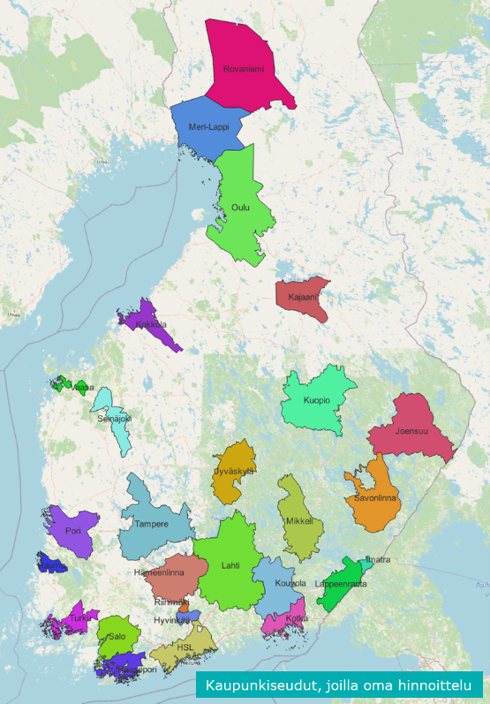

# EMME-verkon kuvaus
EMME-verkko kuvaa valtakunnallisen liikennemallijärjestelmän liikenneverkkoa. Verkko sisältää tie- ja katuverkon, joukkoliikennelinjastot, kävely- ja pyöräliikenteen yhteydet sekä tavaraliikenteen yhteydet. Verkkoa käytetään henkilö- ja tavaraliikenteen sijoitteluissa. Verkko muodostuu solmuista, linkeistä ja joukkoliikennelinjoista.

Noudata verkkoa muokatessasi tämän sivun periaatteita, jotta tulokset ovat oikeita ja aineistoja voidaan jakaa käyttäjien ja hankkeiden kesken. Useimmat vaatimukset tarkistetaan automaattisesti ennen jokaista malliajoa (ks. kohta _Verkon tarkistukset_ sivun lopussa).

- Koordinaatit ovat ETRS-TM35FIN-tasokoordinaatistossa (EPSG:3067) metreinä. Linkkien pituudet ovat kilometreinä.
- Malli täyttää monet linkkien ja linjojen attribuutit itse jokaisen ajon alussa (esimerkiksi tavallisten tielinkkien kapasiteetit, vapaat nopeudet ja viivytysfunktiot). Näihin attribuutteihin käsin syötetyt arvot ylikirjoitetaan.

## Liikenneverkko

### Solmut

Solmut kuvaavat liikenneverkon risteyksiä, pysäkkejä, asemia ja sijoittelualueiden sentroideja. Solmut voidaan jakaa kahteen pääryhmään:
- liikenneverkon solmut
- sijoittelualueiden sentroidit

*Taulukko x. Solmuavaruuden jako, sentroidit*

| numeroavaruus | selitys |
|---------------|---------|
| 100 - 35 999      | sentroidit, Suomen sisäiset |
| 36 000 – 36 999 | sentroidit, Tornionjokilaakso (Ruotsi) |
| 37 000 – 50 099 | VAPAA |
| 50 100 - 50 199 | ulkomaan rajapaikat ja satamat |
| 50 200 - 59 999 | ulkomaan sentroidit (Eurooppa ja muu maailma) |
| 60 000 - 60 999 | ulkomaan sentroidit (Viro, Ruotsi, Norja, Tanska, Latvia) |
| 61 000 - 99 999 | VAPAA |

*Taulukko x. Solmuavaruuden jako, muut solmut kuin sentroidit*

| numeroavaruus | selitys |
|---------------|---------|
| 100 000 - 899 999    | käytetyt solmut |
| 900 000 - 999 999 | VAPAA |

*Taulukko x. Solmujen attribuuttitiedot*

| attribuutti      | selitys                                                      | Pakollinen |
|-------|------|------|
| i   |  yksilöllinen tunniste          |  ✓ |
| ui1   | väliaikainen tieto, VAPAA               |
| ui2   | VAPAA                                |
| ui3   | VAPAA |
| #municipality | Kunnan nimi |
| #park_cost_n | Liityntäpysäköinnin hinta (e/h) |
| #subarea | 2 = osamallin oma alue. Vain linkit, joiden alkusolmun arvo on 2, lasketaan mukaan osamallin ajoneuvo- ja henkilökilometreihin, linkkipituuksiin ja joukkoliikenteen suoritteisiin, ja vain niiden auton matka-ajat tallennetaan tiedostoon netfield_links_<osamalli>.txt (tallennetun nopeuden sijoittelu). Muita arvoja malli ei käytä. |  ✓ |
| #transit_stop_b | Bussipysäkki | ✓ |
| #transit_stop_e | Kaukobussipysäkki | ✓ |
| #transit_stop_g | Runkobussipysäkki | ✓ |
| #transit_stop_p | Pikaratikkapysäkki | ✓ |
| #transit_stop_t | Ratikkapysäkki | ✓ |

*✓ = Pakollinen attribuutti, joka tulee määrittää verkkotiedostossa.*

#### Sentroidit
Sentroidit edustavat liikennemallin sijoittelualueita. Sijoittelualueiden liikenne kytkeytyy varsinaiseen liikenneverkkoon sentroidien ja niitä ympäröivien konnektoreiden avulla.

Sentroidien numeroiden tulee olla samat kuin osamallin kohdistussarakkeen aluenumerot aluetiedoissa (ks. [Aluetiedot](malliajon_lahtotiedot.md)). Osalla sentroideista on mallissa kiinteä rooli, esimerkiksi tavaraliikenteen mallin käyttämillä kotimaan satamilla ja raja-asemilla sekä ulkomaan sentroideilla (ks. [Sentroidien numerointi](sentroidien_numerointi.md)). Näitä sentroideja ei saa numeroida uudelleen.

### Kulkumuodot

EMMEssä kulkumuodot määrittävät, millä verkon linkeillä eri liikennemuodot voivat kulkea. Kulkumuotojen kuvauksessa on eroteltu tavaraliikenteen käyttämät kulkumuodot (isot kirjaimet) ja henkilöliikenteen käyttämät kulkumuodot (pienet kirjaimet).

Valtakunnallisessa liikennemallissa autoliikenteen pääkulkumuoto on h (auto). Kaikilla aux. auto -kulkumuotoa käyttävillä linkeillä on sallittava myös pääkulkumuoto h.

Jokaisella linkillä tulee olla vähintään yksi kulkumuoto. Linkillä ei saa olla pelkästään kulkumuotoa h: jos h on määritetty, linkillä tulee olla myös jokin muu kulkumuoto. Malli tarkistaa kulkumuotojen tyypit ennen jokaista ajoa.

Joukkoliikenteen kulkumuodot (transit) määrittävät joukkoliikennelinjojen käyttämät linkit. Joukkoliikenteen apukulkumuodoilla (aux. transit) kuvataan esimerkiksi kävelyä pysäkeille ja vaihtoyhteyksiä linjojen välillä.

*Taulukko x. Kulkumuotojen (modes) kuvaus*

| **Kulkumuoto** | **Kuvaus** | **Tyyppi** 
|---|---|---|
| `h` | Pääkulkumuoto | auto |
| `c` | Henkilöauto | aux. auto |
| `v` | Pakettiauto | aux. auto |
| `k` | Kuorma-auto | aux. auto |
| `y` | Perävaunullinen kuorma-auto | aux. auto |
| `r` | Lähijuna | transit |
| `j` | Kaukojuna | transit |
| `t` | Raitiovaunu | transit |
| `p` | Pikaraitiovaunu | transit |
| `m` | Metro | transit |
| `b` | Linja-auto | transit |
| `g` | Runkobussi | transit |
| `e` | Pitkän matkan linja-auto | transit |
| `l` | Lentoliikenne | transit |
| `w` | Lautta | transit |
| `d` | Pitkän matkan lautta | transit |
| `a` | Kävely | aux. transit |
| `f` | Pyöräily | aux. transit |
| `u` | Liityntäpysäköinti | aux. transit |
| `D` | Dieseljuna | transit |
| `J` | Sähköjuna | transit |
| `W` | Kotimaan vesiliikenne | transit |
| `C` | Konttialus | transit |
| `G` | Yleinen rahtialus | transit |
| `L` | LNG-tankkeri | transit |
| `O` | Öljytankkeri | transit |
| `P` | Tuotetankkeri | transit |
| `R` | Ro-ro-alus | transit |
| `T` | Raakapuu syöttöliikenne | aux. transit |
| `F` | Tavaraliikenne syöttöliikenne| aux. transit |

### Linkit

Uusia linkkejä luodessa tulee määrittää linkille linkkityyppi (type), linkillä sallitut kulkumuodot (modes) sekä kaistamäärä (lanes). Malliajossa määritetään linkkityypin perusteella automaattisesti muut tarvittavat attribuutit, eli sijoittelufunktion numero (vdf), kaistakapasiteetti (ul1) sekä vapaa nopeus (ul2).

*Taulukko x. Linkkien ominaisuudet*

| kenttä          | kuvaus                                                 | Pakollinen |
|-----------------|--------|---|
| type            | ks. taulukko x  |  ✓ |
| length          | linkin pituus   |  |
| lanes           | kaistamäärä |  ✓ |
| modes           | kulkumuodot (taulukko x)   |  ✓ |
| vdf             | sijoittelufunktion nro (määritetään malliajossa automaattisesti)   |
| ul1 | linkin yhden kaistan kapasiteetti (ajon./h/kaista) (määritetään malliajossa automaattisesti) |
| ul2             | linkin vapaa nopeus (km/h) (määritetään malliajossa automaattisesti)      |
| ul3             | Taustaliikenne (määritetään malliajossa automaattisesti: bussien ajoneuvomäärä, henkilöliikenteen sijoittelussa kuorma-autot tai tavaraliikenteen lisäkustannus). Älä tallenna attribuuttiin omia tietojasi, sillä malli ylikirjoittaa sen. |
| @ferry_wait_time |  Lauttojen odotusaika (min). Lisätään autolauttalinkkien matka-aikaan. | ✓ |
| @toll_cost_vrk      | Tienkäyttömaksu VRK-ajanjaksolla |
| @freight_gate      |  Tavaraliikenteen satamiin ja raiteisiin johtavan kuorma-autolinkin lähimmän aluesyötön id (positiivinen lähdesolmuille, negatiivinen kohdesolmuille). 0, jos linkki ei johda satamaan tai raiteille.  | ✓ |
| #buslane            | Tosi, jos linkillä on joukkoliikennekaista. Viivytysfunktioksi vaihdetaan tällöin bussikaistaversio (funktiot 6–10), jossa yksi kaista on varattu busseille, eikä busseja lasketa autoliikenteen taustaliikenteeksi. | ✓ |
| #car_time_aht      | Ennalta määritetty auton matka-aika (AHT)    | ✓ |
| #car_time_iht      |  Ennalta määritetty auton matka-aika (IHT)   | ✓ |
| #car_time_it      |  Ennalta määritetty auton matka-aika (IT)   | ✓ |
| #car_time_pt      | Ennalta määritetty auton matka-aika (PT)    | ✓ |
| #car_time_vrk      |  Ennalta määritetty auton matka-aika (VRK)   | ✓ (pitkien matkojen malli) |
| #dr_leveys      | Linkin leveys (Digiroad) |
| #dr_linkkityyp      | Linkin tyyppi (Digiroad) |
| #dr_nopeusrajoitus      | Linkin nopeusrajoitus (Digiroad) |
| #dr_toiminn_lk      | Linkin toiminnallinen luokka (Digiroad) |
| #extra_cost      | Ennalta määritetty lisäkustannus tavaraliikenteelle (kokonaisluku)    |
| #hinta_aht      | Tienkäyttö- tai ruuhkamaksu AHT-ajanjaksolla (€) |
| #hinta_pt      | Tienkäyttö- tai ruuhkamaksu PT-ajanjaksolla (€) |
| #hinta_iht      | Tienkäyttö- tai ruuhkamaksu IHT-ajanjaksolla (€) |
| #hinta_vrk      | Hinta VRK-ajanjaksolla |
| #road_number      |  Tien numero valtion omistamilla teillä   |
| #road_part_nr_max      |  Suurin tienosan numero linkillä   |
| #road_part_nr_min      | Pienin tienosan numero linkillä    |
| #street_name      | Kadun nimi suomeksi    |
| #traffic_light      | Tosi, jos linkki on lähellä liikennevaloa. Jos linkin vapaa nopeus on alle 65 km/h, kaistakapasiteetti kerrotaan luvulla 0,9 ja vapaa nopeus luvulla 0,85.    |

*✓ = Pakollinen attribuutti, joka tulee määrittää verkkotiedostossa.*

Ennalta määritetyt auton matka-ajat (`#car_time_*`) ovat minuutteja. Niitä käytetään tallennetun nopeuden sijoittelussa, ja ne voivat olla 0, mutta eivät negatiivisia. Malli kirjoittaa arvot jokaisen ajon lopussa tulostiedostoon `netfield_links_<osamalli>.txt`, jonka voi tuoda toiseen skenaarioon, jotta sijoittelut voidaan ajaa samoilla nopeuksilla (ks. [Mallijärjestelmän käyttö](mallijarjestelman_kaytto.md)).

Jos tienkäyttömaksukentät (`#hinta_*`) ovat verkossa, maksut huomioidaan autoliikenteen reitinvalinnassa ja tuloksiin tuotetaan tienkäyttömaksumatriisit.

*Taulukko 9. Linkkityypit (link type)*

| linkkityyppi (link type) | selitys | modes |
|--------------------------|---------|---------|
| 2       | ratikka           | tp |
| 3       | metro       | m |
| 4       | juna  | JrjD, rj, rjD |
| 7       | lento      | l |
| 99      | syöttölinkki   | af, ckyvabfgeTF, TF, F, T, afF, afT |
| 101–141 | jalankulku, pyöräily, autot, bussit  | ckyvabfge, ckvabfge, abfge |
| 144 | laivat ja lautat    | ckyvawdbfge, ckyvwdbge, wdWCGLOPR, WCGLOPR, wdW, CGLOPR |

#### Syöttölinkit
Syöttölinkeillä (linkkityyppi 99) sentroidit yhdistetään ympäröivään verkkoon. Jokaisesta sentroidista on olemassa yksi autoliikenteen ja yksi kävely- ja pyöräliikenteen syöttölinkki lähimpiin solmuihin. Autoliikenteen syöttölinkkiä ei saa yhdistää moottoritiehen, ramppeihin, liikenneympyröihin tai kaksiajorataisiin katuihin/teihin.

*Taulukko x. Sijoittelufunktioiden jako väylätyyppeihin*

| Linkkityyppi | Kuvaus | Toiminnallinen luokka | Nopeusrajoitus (km/h) | Tien leveys | Viivytysfunktio (vdf) | Kaistakapasiteetti (ul1) (ajon./h/kaista) | Vapaa nopeus (ul2) (km/h) |
|---|---|---|---|---|---|---|---|
| 101 | moottoritie | 1 | 120 | pääväylä | 1 | 2100 | 113 |
| 103 | moottoritie, kaistoja ≥3 | 1| 120 | | 1 | 1900 | 113 |
| 104 | moottoritie |1 | 100 | | 1 | 2000 | 97 |
| 105 | moottoritie, kaistoja ≥3 | 1| 100 | | 1 | 1800 | 97 |
| 106 | moottoritie | 1| 80 | | 1 | 2000 | 81 |
| 107 | moottoritie, kaistoja ≥3 |1 | 80 | | 1 | 1800 | 81 |
| 116 | ramppi |1-4 | 60–120 | | 2 | 1600 | 63 |
| 125 | ramppi |1-4 | 50 | | 4 | 1150 | 48 |
| 128 | ramppi |1-4 | 20–40 | | 4 | 1000 | 41 |
| 108 | valtatie | 1 | 100 | | 2 | 1900 | 97 |
| 110 | valtatie | 1 | 90 | | 2 | 1900 | 90 |
| 112 | valtatie | 1 | 80 | | 2 | 1850 | 81 |
| 114 | valtatie | 1 | 70 | | 2 | 1600 | 73 |
| 116 | valtatie | 1 | 60 | | 2 | 1600 | 63 |
| 109 | kantatie, seututie, yhdystie | 2-4 | 100 | | 2 | 1700 | 97 |
| 111 | kantatie, seututie, yhdystie | 2-4 | 90 | | 2 | 1700 | 90 |
| 113 | kantatie, seututie, yhdystie | 2-3 | 80 | ≥6m | 2 | 1650 | 81 |
| 114 | kantatie, seututie, yhdystie | 4 | 80 | ≥6m | 2 | 1600 | 73 |
| 115 | kantatie, seututie, yhdystie | 2-3 | 80 | <6m | 2 | 1500 | 73 |
| 117 | kantatie, seututie, yhdystie | 4 | 80 | <6m | 2 | 1400 | 63 |
| 115 | kantatie, seututie, yhdystie | 2-4 | 70 | | 2 | 1500 | 73 |
| 117 | kantatie, seututie, yhdystie | 2-3 | 60 | ≥6m | 2 | 1400 | 63 |
| 121 | kantatie, seututie, yhdystie | 4 | 60 | ≥6m | 3 | 1200 | 58 |
| 124 | kantatie, seututie, yhdystie | 2-4 | 60 | <6m | 3 | 1100 | 63 |
| 122 | yksityistie | 5 | 100 | | 3 | 1100 | 73 |
| 122 | yksityistie | 5 | 90 | | 3 | 1100 | 73 |
| 122 | yksityistie | 5 | 80 | ≥6m | 3 | 1100 | 73 |
| 124 | yksityistie | 5 | 80 | <6m | 3 | 1100 | 63 |
| 124 | yksityistie | 5 | 70 | | 3 | 1100 | 63 |
| 124 | yksityistie | 5 | 60 | ≥6m | 3 | 1100 | 63 |
| 126 | yksityistie | 5 | 60 | <6m | 4 | 1050 | 48 |
| 125 | valtatie | 1 | 50 | | 4 | 1150 | 48 |
| 128 | valtatie | 1 | 40 | | 4 | 1000 | 41 |
| 135 | valtatie | 1 | 30 | | 5 | 700 | 30 |
| 139 | valtatie | 1 | 20 | | 5 | 700 | 20 |
| 126 | kantatie, seututie, yhdystie |2-3 | 50 | | 4 | 1050 | 48 |
| 127 | kantatie, seututie, yhdystie |4 | 50 | | 4 | 1000 | 44 |
| 129 | kantatie, seututie, yhdystie |2-3 | 40 | | 4 | 900 | 41 |
| 133 | kantatie, seututie, yhdystie |4 | 40 | | 5 | 750 | 36 |
| 136 | kantatie, seututie, yhdystie |2-3 | 30 | | 5 | 600 | 25 |
| 137 | kantatie, seututie, yhdystie |4 | 30 | | 5 | 550 | 20 |
| 140 | kantatie, seututie, yhdystie |2-4 | 20 | | 5 | 600 | 15 |
| 133 | yksityistie |5 | 50 | | 5 | 750 | 36 |
| 134 | yksityistie |5 | 40 | | 5 | 600 | 36 |
| 138 | yksityistie |5 | 30 | | 5 | 500 | 18 |
| 141 | yksityistie |5 | 20 | | 5 | 500 | 12 |

Edellisen taulukon lisäksi malli tuntee seuraavat linkkityypit, joille se asettaa viivytysfunktion, kaistakapasiteetin ja vapaan nopeuden:

*Taulukko x. Muut linkkityypit*

| Linkkityyppi | Kuvaus | Viivytysfunktio (vdf) | Kaistakapasiteetti (ul1) (ajon./h/kaista) | Vapaa nopeus (ul2) (km/h) |
|---|---|---|---|---|
| 102 | moottoritie | 1 | 2100 | 113 |
| 118 | pääväylä | 3 | 1400 | 97 |
| 119 | pääväylä | 3 | 1400 | 90 |
| 120 | | 3 | 1350 | 81 |
| 123 | pääväylä | 3 | 1250 | 54 |
| 130 | kokoojaväylä | 5 | 900 | 48 |
| 131 | kokoojaväylä | 5 | 900 | 41 |
| 132 | kokoojaväylä | 5 | 900 | 36 |
| 144 | autolautta | 11 | 500 | 20 |
| 99 (sekä linkkityypit, joiden kaksi viimeistä numeroa ovat 84–88 tai 98) | syöttölinkki | 99 | – | 50 |

Muut linkkityyppejä koskevat säännöt:
- __Erikoislinkit:__ linkeille, jotka eivät sovi vakioluokkiin, käytetään linkkityyppejä, joiden kaksi viimeistä numeroa ovat 91 (moottoritie), 92 (valtatie), 93 tai 94 (pääväylä) tai 95 (katu). Käyttäjän tulee tällöin syöttää vapaa nopeus attribuuttiin ul2. Viivytysfunktio valitaan tietyypin mukaan.
- __Kiinteän nopeuden linkit:__ jos linkin viivytysfunktio on 90, malli ei muuta sitä. Matka-aika lasketaan tällöin linkin pituudesta ja ul2-attribuutin nopeudesta.
- __Vaihtokävelylinkit:__ linkit, joiden linkkityypin kaksi viimeistä numeroa ovat 70, voivat olla nollan pituisia. Kaikkien muiden linkkien pituuden tulee olla suurempi kuin nolla.
- __Kielletyt linkkityypit:__ linkkityyppejä 100 ja 999 ei saa käyttää.
- __Linkit ilman autoliikennettä__ (ei autokulkumuotoja) saavat viivytysfunktion 0.

*Taulukko x. Malliajon alussa luotavat viivytysfunktiot*

| Funktio | Käyttö |
|---|---|
| fd1–fd5 | Autolinkit tietyypeittäin: 1 moottoritie, 2 valtatie, 3 monikaistainen pääväylä, 4 pääväylä, 5 kokooja- ja tonttikatu |
| fd6–fd10 | Kuten fd1–fd5, linkillä on bussikaista |
| fd11 | Autolautta: matka-aika nopeudesta sekä lautan odotusaika |
| fd90, fd91, fd99 | Kiinteä nopeus ul2-attribuutista (kiinteän nopeuden linkit, tallennetun nopeuden sijoittelu, syöttölinkit) |
| fd97 | Liityntäpysäköinnin syöttölinkit (kävelynopeus 5 km/h) |
| fd70–fd78, fd98 | Pyöräily |

Pankissa jo olevat samannumeroiset funktiot ylikirjoitetaan. Autoliikenteen funktiot ovat BPR-tyyppisiä funktioita, jotka kuvaavat matka-ajan kasvua liikennemäärän lähestyessä kapasiteettia. Kapasiteetin ylittävällä osalla funktiota on jatkettu lineaarisesti.

#### Pyöräilyverkko
Pyöräily käyttää linkkejä, joilla on kulkumuoto `f`. Pyöräilysijoittelun ajaksi kaikille pyöräilylinkeille asetetaan väliaikaisesti pääkulkumuoto `h`.

### Tie- ja katuverkon koodausperiaatteet

Aluesyötöt yhdistetään lähimpään solmuun, joka on saavutettavissa ajoneuvoilla. Solmusta täytyy lähteä linkki, joka on tyyppiä "Yksiajorataisen tien osa". Toisin sanoen autoliikenteen syöttölinkkiä ei yhdistetä moottoritiehen, ramppeihin, liikenneympyriin tai kaksiajorataisiin katuihin/teihin.
Jokaisesta centroidista tehdään lisäksi yksi kävelylinkkisyöttö vastakkaiseen suunnan lähimpään solmuun. Tämän solmun täytyy olla aluetta kuvaavan polygonin sisällä.

Jokaisen malliajon yhteydessä linkkien ul1 (kapasiteetti), ul2 (vapaa nopeus) ja vdf (viivytysfunktio) -arvot ylikirjoitetaan linkkityypin perusteella, joten niitä ei tarvitse määritellä erikseen linkeille. 

Eritasoliittymien erkanemis- ja liittymiskaistoja ei lähtökohtaisesti ole huomioitu kaistamäärissä. Jos liittymis- ja erkanemiskaistat ulottuvat toisiinsa asti kattaen kahden eritasoliittymän välisen matkan kokonaan, ne on otettu huomioon kaistamäärässä.

Tasoliittymien kääntymiskaistoja ei ole lähtökohtaisesti huomioitu, vaan kaistamäärä on kuvattu pääsuunnan liittymän läpi kulkevien kaistojen määrän perusteella. Tilanteessa, jossa kääntymiskaista ulottuu yli viereisen liittymän siten, että kääntymiskaistan vuoksi seuraavassa liittymässä on useampi läpi kulkeva kaista, kääntymiskaista on huomioitu myös liittymien välisellä osuudella. 

Joukkoliikennekaistat on laskettu mukaan kaistamäärään ja näistä on tieto omassa attribuutissa. Joukkoliikennekaistat huomioidaan mallijärjestelmässä viivytysfunktioissa.

## Joukkoliikenne

### Joukkoliikenteen ajoneuvotyypit

*Taulukko x. Joukkoliikenteen ajoneuvotyypit, niitä vastaavat kulkumuodot ja kuvaus.

| Ajoneuvotyyppi (vehicle) | Kuvaus | Kulkumuoto (mode) | Ajoneuvossa vietetyn ajan painokerroin |
|---|---|---|---|
| 1 | Linja-auto | `b` | 1,0 |
| 2 | Raitiovaunu | `t` | 0,8 |
| 3 | Juna | `j` | 0,8 |
| 4 | Metro | `m` | 0,8 |
| 5 | Lautta | `w` | 1,0 |
| 6 | Lentokone | `l` | 1,0 |
| 7 | Pikaraitiovaunu | `p` | 0,8 |
| 8 | Pitkän matkan linja-auto | `e` | 1,0 |
| 9 | Lähijuna | `r` | 1,0 |
| 10 | Runkobussi | `g` | 1,0 |
| 11 | VR:n lähijuna | `j` | 1,0 |
| 12 | Kiskobussi | `j` | 1,0 |
| 13 | Pitkän matkan päivälautta | `d` | 1,0 |
| 14 | Pitkän matkan yölautta | `d` | 1,0 |
| 20 | Kotimaan vesialus | `W` | |
| 23 | Konttialus | `C` | |
| 24 | Yleinen rahtialus | `G` | |
| 25 | LNG-tankkeri | `L` | |
| 26 | Öljytankkeri | `O` | |
| 27 | Tuotetankkeri | `P` | |
| 28 | Ro-ro-alus | `R` | |
| 30 | Tavarajuna, diesel | `D` | |
| 31 | Tavarajuna, sähkö | `J` | |

Ajoneuvotyyppien numeroilla on mallissa kiinteä merkitys. Ajoneuvossa vietetty aika painotetaan (koettu matka-aika) taulukon kertoimella. Ajoneuvojen istuma- ja kokonaiskapasiteetit annetaan ajoneuvotiedostossa.

### Nousu- ja vaihtosakot

Noususakot (min) riippuvat kulkumuodosta. Pitkien matkojen sijoittelussa pitkän matkan kulkumuodoille käytetään suurempia sakkoja.

| Kulkumuoto | Paikallinen sijoittelu | Pitkien matkojen sijoittelu |
|---|---|---|
| Linja-auto `b` | 5 | 5 |
| Pitkän matkan linja-auto `e` | 5 | 25 |
| Runkobussi `g` | 3 | 3 |
| Raitiovaunu `t`, pikaraitiovaunu `p`, metro `m`, lautta `w`, lähijuna `r` | 0 | 0 |
| Pitkän matkan lautta `d` | 5 | 25 |
| Kaukojuna `j` | 0 | 25 |
| Lentoliikenne `l` | 0 | 25 |

Lisäksi jokaisesta vaihdosta lisätään 10 minuutin vaihtosakko. Odotusaika lasketaan efektiivisistä vuoroväleistä (ks. kohta _Joukkoliikennelinjastot_), ja siihen lisätään vuorovälin vaihtelusta laskettu odotusaikasakko (`@wait_time_dev`) kertoimella 3,5. Kävelyaika (aux. transit) painotetaan sijoitteluluokassa `transit` kertoimella 1,75 ja muissa joukkoliikenteen sijoitteluluokissa (lentoliikenne sekä auto- ja taksiliityntäluokat) kertoimella 2,5.

### Joukkoliikennelinjojen pysähtymiskäyttäytyminen
Joukkoliikennelinjoilla on linja-attribuutti `#keep_stops`, jolla määritetään, miten linjan pysähtymiskäyttäytyminen määräytyy.

- **`#keep_stops = 0`:** Pysähtyminen määräytyy noodien kulkumuotokohtaisten attribuuttien `#transit_stop_b`, `#transit_stop_e`, `#transit_stop_g`, `#transit_stop_p` ja `#transit_stop_t` perusteella.
- **`#keep_stops = 1`:** Linja pysähtyy niillä pysäkeillä, jotka on määritetty pysäkkisegmenteille (attribuutit noali ja noboa).

Attribuutti `#keep_stops` koskee vain seuraavia kulkumuotoja: `b` (bussi), `e` (kaukobussi), `g` (runkobussi), `p` (pikaratikka) ja `t` (ratikka).

### Joukkoliikennelinjastot

Joukkoliikenteen matka-ajat tulevat suoraan segmenttikohtaisesta attribuutista us1, paitsi busseille. Bussien (kulkumuodot b, g ja e) ajoajat määritetään automaattisesti malliajon autosijoittelussa, paitsi jos tiellä on erillinen bussikaista, jolloin ajoaika määräytyy linkin vapaan nopeuden mukaan. Sekaliikenteessä bussin ajoaika on autoliikenteen ruuhkautunut matka-aika, kuitenkin enintään 100 km/h nopeutta vastaava. Sijoittelussa otetaan huomioon dwell time (dwt) -attribuutissa busseille merkatut yli kahden minuutin pysähtymisajat, muuten ajoaikaan lisätään kiinteä viive 24 sekuntia per pysäkki.

Vuorovälejä koskevat säännöt:
- Jokaisella joukkoliikennelinjalla tulee olla jokaisella ajanjaksolla vähintään 0,02 minuutin vuoroväli. Muuten ajo pysähtyy virheeseen _"Headway missing for line …"_.
- Jos linja ei liikennöi jollakin ajanjaksolla, käytä vuoroväliä 999. Tällaiset linjat jätetään pois autolinkkien bussitaustaliikenteestä ja joukkoliikenteen ajoneuvokilometreistä.
- Malli muuntaa vuorovälit _efektiivisiksi vuoroväleiksi_, jotka kuvaavat koettua odotusaikaa. Paikallisliikenteessä odotusaika on tiheillä vuoroväleillä likimain verrannollinen vuoroväliin ja kasvaa harvemmilla vuoroilla hitaammin.

### Pitkän matkan joukkoliikenne ja liityntäpysäköinti

Pitkän matkan joukkoliikenteeseen voi pitkien matkojen mallissa liittyä autolla tai taksilla. Kaukojunaan (`j`), pitkän matkan lauttaan (`d`) ja lentoliikenteeseen (`l`) voi liittyä sekä autolla että taksilla, pitkän matkan linja-autoon (`e`) vain taksilla. Linkit, jotka yhdistävät kulkumuotojen `j`, `d` ja `l` pysäkit verkkoon mutta joita linjat eivät itse käytä, käsitellään automaattisesti liityntäpysäköinnin syöttölinkkeinä.

### Joukkoliikenteen hinnoittelu

Jokaiselle joukkoliikennelinjalle tulee määrittää hintatunnus eli hinta-id (attribuutti ut1). Hinta-id kuvaa linjalla käytettävää hinnoitteluperustetta. Sitä vastaavat varsinaiset hinnat määritetään hintadatan (cost.json) kohdassa `transit_cost`: malli hakee linjan hinnan siitä `transit_cost`-kohdan merkinnästä, jonka `id` on sama kuin linjan ut1-arvo, ja käyttää sen nousukohtaista hintaa (`firstb_single`, €) ja kilometrihintaa (`dist_single`, €/km). Jos hintadatasta ei löydy linjan hinta-id:tä, ajo pysähtyy virheeseen _No transit fares for operator id N_. Hinta-id ja niiden selitykset on esitetty taulukossa x.

Samalla joukkoliikennelinjalla ei pystytä kuvaamaan eri hintafunktioita yksinkertaisesti EMME-mallissa. Tämä on ongelma seudullisilla junilla, joita voi käyttää paikallisen toimivaltaisen viranomaisen lipuilla (HSL, NYSSE), mutta alueen ulkopuolella tarvitaan VR:n lippu. Tästä johtuen HSL:n ja NYSSE:n alueelle päättyvät R, T, Z, M ja D-junat on lisätty malliin tuplana: Toisella linjalla nousut/poistumiset on kielletty HSL/NYSSE-alueella siten, että linjaa voi käyttää vain seuturajat ylittävään matkaan. Toinen linja on katkaistu seudun sisälle, jolloin sitä käytetään vain seudun sisäisiin matkoihin. Näille linjoille on eri hintafunktiot. Tässä on hyödynnetty custom transit lines –ominaisuutta. 

*Taulukko x. Joukkoliikennelinjojen hintatunnukset*

| Hinta-id | Alue |
|---|---|
| 1 | HSL |
| 2 | Hyvinkää |
| 3 | Hämeenlinna |
| 4 | Imatra |
| 5 | Joensuu |
| 6 | Jyväskylä |
| 7 | Kajaani |
| 8 | Kokkola |
| 9 | Kotka |
| 10 | Kouvola |
| 11 | Kuopio |
| 12 | Lahti |
| 13 | Lappeenranta |
| 14 | Meri-Lappi |
| 15 | Mikkeli |
| 16 | Oulu |
| 17 | Pori |
| 18 | Raasepori |
| 19 | Rauma |
| 20 | Riihimäki |
| 21 | Rovaniemi |
| 22 | Salo |
| 23 | Savonlinna |
| 24 | Seinäjoki |
| 25 | Tampere |
| 26 | Turku |
| 27 | Vaasa |
| 28 | lennot |
| 29 | lautat |
| 30 | taajamajunat |
| 31 | lähijunat |
| 32 | kaukojunat |
| 33 | kaukobussit |
| 34 | lautta Helsinki-Tukholma |
| 35 | lautta Turku-Tukholma |
| 36 | lautta Vaasa-Uumaja |
| 37 | lautta Helsinki-Tallinna |

**Kuva x. Joukkoliikenteen hinnoittelualueet**

*Taulukko x. Joukkoliikennelinjan perusattribuutit*

| Attribuutti | Kuvaus | Pakollinen henkilöliikenteessä | Pakollinen tavaraliikenteessä |
|---|---|---|---|
| `name` | Linjan yksilöivä tunnus. | ✓ | ✓ |
| `description` | Linjan kuvaus. | ✓ | ✓ |
| `mode` | Linjan kulkumuoto, esim. `b`, `e`, `g`, `p` tai `t`. | ✓ | ✓ |
| `vehicle` | Ajoneuvotyyppi. | ✓ | ✓ |
| `hdw` | Vuoroväli (määritetään malliajossa) | |
| `speed` | Oletusnopeus (määritetään malliajossa) | |
| `lay1` | Päätepysäkin seisonta-aika minuutteina (määritetään malliajossa) | |
| `ut1` | Henkilöliikenteessä joukkoliikennelinjan hinta-id (vastaa hintadatan `transit_cost`-kohdan `id`-arvoa). Tavaraliikenteessä laivalinjan pituus (km) | ✓ | Laiva ✓ |
| `ut2` | Henkilöliikenteessä efektiivinen vuoroväli (määritetään malliajossa, ylikirjoitetaan). Tavaraliikenteessä laivalinjan frekvenssi (lähtöjen määrä vuodessa). | |Laiva ✓ |
| `ut3` | Ajoneuvossa vietetyn ajan painokerroin (määritetään malliajossa, ylikirjoitetaan). | |
| `#agency_name` | Operaattorin nimi. | |
| `#departures_per_day` | Vuorojen määrä per vrk | |
| `#hdw_aht` | Vuoroväli aamuhuipussa (klo 6–9). | ✓ |
| `#hdw_iht` | Vuoroväli iltahuipussa (klo 15–18). | ✓ |
| `#hdw_it` | Vuoroväli iltatunnissa (klo 18–21). | ✓ |
| `#hdw_pt` | Vuoroväli päivätunnissa (klo 9–15). | ✓ |
| `#hdw_vrk` | Vuorokauden keskimääräinen vuoroväli (vuorojen määrä per vrk / 960) | ✓ |
| `#keep_stops` | 1 = Linja säilyttää alkuperäisen pysähtymiskäyttäytymisensä, 0 = Pysähtyminen määräytyy noodien #transit_stop-attribuuttien perusteella | ✓ |
| `#route_short_name` | Route short name (GTFS). | |
| `#trip_short_name` | Trip short name (GTFS). | |

*✓ = Pakollinen attribuutti, joka tulee määrittää verkkotiedostossa.*

*Taulukko x. Joukkoliikennesegmenttien perusattribuutit*

| attribuutti | kuvaus |
|---|---|
| `line` | Joukkoliikennelinja |
| `i` | Segmentin I-solmu |
| `j` | Segmentin J-solmu |
| `dwt` | Pysähdyksen kesto |
| `noali` | Ei poistumista I-solmusta (huomioidaan vain jos linjalla #keep_stops = 1) |
| `noboa` | Ei nousemista I-solmusta (huomioidaan vain jos linjalla #keep_stops = 1)|
| `dwfac` | (ei käytössä) |
| `ttf` | Joukkoliikenteen matka-aikafunktio (määrittyy malliajon aikana automaattisesti) |
| `us1` | Matka-aika pysäkkien välillä (min), ei käytössä kulkumuodoilla b, g ja e |
| `us2` | Matkan pituuteen perustuva lipunhinta (määritetään malliajossa, ylikirjoitetaan) |
| `us3` | (ei käytössä) |

## Tavaraliikenne
Tavara- ja henkilöliikenteen verkot ovat pääosin yhteisiä ja ne on tehty mallissa samaan verkkokuvaukseen/skenaarioon. Prosessilla on mahdollista tuottaa myös pelkästään henkilöliikennettä koskeva kuvaus. Tavaraliikenteen kuvaus hyödyntää muutamia täydentäviä tietolähteitä raiteista ja vesiväylistä ja tietyt terminaalit/lastauspaikat ovat vaatineet erityiskäsittelyä verkossa. 

Rautatie- ja vesiväylien sijoittelu- ja vastuslaskennan periaatteena on EMME:n joukkoliikennepohjainen sijoittelu. Jokaista vesiväylä- ja raidelinkkiä kohden on tehty "joukkoliikennelinja", jolla kuljetukset tapahtuvat. 

Rautatieverkolle on liitetty tieto, kulkeeko siinä tavaraliikennettä vai ei. Lisäksi on tiedot raiteiden sähköistyksestä sekä tavaraliikenteen keskimääräisestä kuljetusnopeudesta. Tieto rataosien sähköistyksestä pohjautuu Väyläviraston Rautateiden verkkoselostukseen 2026. Tavaraliikenteen keskimääräinen kuljetusnopeus perustuu todellisiin kuljetustietoihin. Kuljetukset kuvataan kahdella kulkumuodolla, dieseljunalla ja sähköllä kulkevalla junalla. Liikennepaikoille on merkitty käsin tieto, käytetäänkö paikkaa raakapuun, muun tavaran vai molempien lastaukseen. Liikennepaikkatieto pohjautuu rataverkkoselostukseen. Näille paikoille on tehty linkit, joissa kuorma-auton liittyminen asemaan on mahdollista. Muiden kuin valtion omistuksessa olevat rataverkon osat (teollisuusraiteet) ja niillä sijaitsevat liikennepaikat kuvattu verkkoon erikseen suurimpien teollisuuslaitosten osalta.

Satamat yhdistyvät aina vesiväyliin ja niiden osalta, joihin on merkitty tieto yhdistymisestä raiteisiin, on luotu lähimpään rautatiesolmuun yhdistävä linkki.

Verkolle on muodostettu myös @freight_gate attribuutti, joka kertoo satamiin ja raiteisiin johtavan kuorma-autolinkin lähimmän aluesyötön id:n. Tämä attribuutti palvelee kuorma-autolla tehtävien osamatkojen tallennusta matriisimuotoiseksi sijoittelun yhteydessä. Attribuuttia käytetään EMME:n traversal matrix työkalussa.

Digiroadin ajoneuvon suurin sallittu pituus ja suurin sallittu massa -kenttiä on hyödynnetty raskaan liikenteen rajoitusten kuvaamisessa. Jos linkillä ajoneuvon suurin sallittu pituus on enintään 22 metriä tai massarajoitus enintään 42 000 kg, on sen käyttö kielletty yhdistelmäajoneuvoilta. Jos ajoneuvon suurin sallittu pituus on 6 metriä tai massarajoitus 8000 kg, on linkeillä lisäksi kielletty kuorma-autot.

Tiekuljetukset voivat käyttää pääosin kaikkea tieverkkoa. Suurten kaupunkien keskusta-alueille on kuitenkin kuvattu raskaiden ajoneuvojen rajoituksia. Kattavaa tietoa rajoituksista ei ole. Rajoituksia voidaan jatkossa kuvata myös muille, nyt rajoittamattomille alueille tai yksittäisille tienkohdille. Rajoitukset on kuvattu siten, että rajoitusalueen läpi ei pääse ajamaan, mutta jokaiselle osa-alueelle pääsee yhtä reittiä myös eri ajoneuvoluokkien raskailla ajoneuvoilla.

## Verkon tarkistukset

Ennen jokaista käyttöliittymästä käynnistettyä ajoa lähtötiedostot ja verkko tarkistetaan. Ajo pysähtyy virheilmoitukseen, jos
- verkosta puuttuu pakollinen network field -attribuutti (`#transit_stop_b`, `#transit_stop_e`, `#transit_stop_g`, `#transit_stop_p`, `#transit_stop_t`, `#subarea`, `#buslane`, `#keep_stops` sekä ajon ajanjaksojen `#car_time_<ajanjakso>` ja `#hdw_<ajanjakso>`; alueellisissa osamalleissa aht, pt, iht ja it, pitkien matkojen mallissa vrk) tai ekstra-attribuutti (`@ferry_wait_time`, `@freight_gate`)
- kulkumuoto puuttuu tai sen tyyppi on väärä
- linkillä ei ole kulkumuotoja tai sillä on pelkästään kulkumuoto `h`
- linkin linkkityyppi on 100 tai 999
- muun kuin vaihtokävelylinkin pituus on nolla
- autolinkin linkkityyppi ei ole mallin tuntema
- autolinkin ennalta määritetty matka-aika on negatiivinen
- joukkoliikennelinjalta puuttuu vuoroväli jollakin ajanjaksolla
- joukkoliikennelinjan hintatunnukselle ei löydy hintatietoja
- Emme-pankissa ei ole riittävästi tilaa ekstra-attribuuteille
- Emme-skenaarion otsikko on yli 56 merkkiä pitkä.

